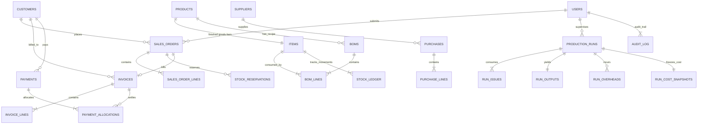

# WEXORA System Design Note
**Product:** WEXORA  
**Tagline:** *Every Order. Every Transaction. Complete Transparency.*  
**Target Organization:** Centre for Digital Infrastructure, NIT Tiruchirappalli  
**Use Case:** Order-to-Audit ERP for Small Food Manufacturer (Packaged South Indian Snacks)

---

## 1. High-Level Architecture & The Two Closed Loops

The fundamental operational challenge of a food processing factory is uniting two distinct physical operational loops at the inventory interface:

1. **The Sales Loop:** Field Salesman order → Admin verification → Stock coverage check & Reservation → GST Tax Invoice → Dispatch (Finished Goods stock deducted) → Accounts Receivables & Collections.
2. **The Production Loop:** Raw Material Purchase → RM Stock → Issue against BOM Recipe → Production Run → Finished Goods Output (FG stock added) → Variance Radar & Unit Costing Snapshot.

```
 SALES LOOP:      Salesman order ──► Admin verifies ──► GST invoice ──► Dispatch ──(Stock -)──┐
                                                                                              ▼
 PRODUCTION LOOP: Purchase ──► Raw stock ──(Issued per BOM)──► Production run ──(Stock +)──► Finished Goods
                                                                                              │
 All Transactions ──► APPEND-ONLY STOCK LEDGER ──► Monthly Auditor Pack & GSTR Reports
```

In **WEXORA**, both loops write immutable delta events (`qty_delta`) to a single **Append-Only Stock Ledger (`stock_ledger`)**. No stock quantity is ever an editable number in a database column. Balances are derived dynamically via `SUM(qty_delta)` and database triggers strictly forbid any `UPDATE` or `DELETE` statements on the ledger.

---

## 2. Entity-Relationship Data Model



### Key Schema Design Decisions:
- **`stock_ledger`**: Contains `item_id`, `qty_delta`, `unit_cost`, `movement_type`, `source_type`, `source_id`, `reverses_id`, and `posted_at`. All stock adjustments or cancellations are posted as compensatory reversal rows with `reverses_id` linked.
- **`stock_reservations`**: Separates *Physical Stock on Hand* from *Allocated Stock*. When an order is approved, active reservations are created:  
  $$\text{Net Available} = \text{On Hand} - \text{Active Reservations}$$  
  This prevents race conditions between salesman orders (e.g. Distributor B cannot take packets already committed to Retailer A).
- **`audit_log`**: Tamper-evident log with SHA-256 hash chaining:  
  $$\text{Hash}_n = \text{SHA256}(\text{Hash}_{n-1} \parallel \text{Timestamp} \parallel \text{User} \parallel \text{Action} \parallel \text{Payload JSON})$$  
  Any external manipulation of the database causes immediate hash-chain failure.

---

## 3. Stock & BOM Consumption Mechanics

### 3.1 Unit Normalization
All inventory balances and stock movements are processed in the **Base Unit** of the item (`kg` for flour/spices, `L` for oil, `piece` for pouches/cartons/packets). Conversions (`g` to `kg`, `mL` to `L`, `carton` to `packet`) are applied via `UnitConverter` before insertion into the ledger.

### 3.2 Recipe Consumption & Variance Logic
When a production run is posted for Murukku 200 g:
1. **Planned Input:**  
   $$\text{Planned Qty} = \text{BOM Standard Qty} \times \text{Batches}$$
2. **Actual Consumption:** Supervisors enter the actual physical weights/volumes issued.
3. **Variance Percentage:**  
   $$\text{Variance \%} = \frac{\text{Actual} - \text{Planned}}{\text{Planned}} \times 100$$
4. **Tolerance Flagging:** If $|\text{Variance \%}| > 3.0\%$, the row is flagged with an alert on the Variance Radar.
5. **Yield Variance:**  
   $$\text{Yield Variance \%} = \frac{\text{Actual Good Output} - \text{Expected Output}}{\text{Expected Output}} \times 100$$  
   For the benchmark: $\frac{188 - 200}{200} \times 100 = -6.0\%$ (Flagged alert).

### 3.3 Packaging Wastage & Scrap Accounting
In food packaging, pouch and carton wastage must be costed directly into the good output.
- **Pouch Consumption:** Good output (188) + Damaged pouches (6) = 194 pouches deducted from stock.
- **Carton Usage:** 9 physical cartons recorded and deducted from stock.

---

## 4. Costing & Valuation Methodology

### 4.1 Chosen Valuation Method: Weighted Average Cost (WAC)
We adopt **Weighted Average Cost (WAC)** recomputed upon every inward receipt (Purchases & Opening Stock).

**Justification:** In food manufacturing, bulk commodities like flour, oil, and spices are stored in continuous silos or mixed storage where physical lot separation is impractical. WAC prevents artificial cost fluctuations between production batches, complies with Indian Accounting Standard (Ind AS 2 / AS-2), and simplifies statutory audit verification.

$$\text{New WAC Rate} = \frac{(\text{Current On-Hand Qty} \times \text{Old WAC Rate}) + (\text{Receipt Qty} \times \text{Receipt Rate})}{\text{Current On-Hand Qty} + \text{Receipt Qty}}$$

*Benchmark Example:*
- Opening flour: 100 kg @ ₹42.00 = ₹4,200.00
- Purchase flour: 60 kg @ ₹45.00 = ₹2,700.00
- Total flour stock: 160 kg, Total value: ₹6,900.00
- **Flour WAC Rate:** $\frac{6900}{160} = \mathbf{₹43.125 / kg}$

### 4.2 Overhead Allocation Rule
Operating expenses (Labour: ₹1,200, Gas & Power: ₹600 = ₹1,800 total) are allocated per run across the **good finished packets produced**. This correctly ensures that production inefficiencies and damaged units raise the net cost per saleable packet.

$$\text{Cost Per Packet} = \frac{\text{Raw Material Cost} + \text{Packaging Material Cost} + \text{Run Overheads}}{\text{Actual Good Packets Produced}}$$

### 4.3 Benchmark Cost Breakdown

| Component | Quantity Used | Unit Rate (₹) | Total Cost (₹) |
| :--- | :--- | :--- | :--- |
| Flour (RM) | 40 kg | 43.1250 (WAC) | 1,725.00 |
| Cooking Oil (RM) | 10.5 L | 140.0000 | 1,470.00 |
| Salt & Spice Mix (RM) | 1.2 kg | 200.0000 | 240.00 |
| 200g Pouch (PM) | 194 pcs (188 good + 6 damaged) | 2.5000 | 485.00 |
| Carton (PM) | 9 pcs | 15.0000 | 135.00 |
| **Subtotal: Direct Materials** | | | **₹4,055.00** |
| Labour Overhead | 1 run | 1,200.00 | 1,200.00 |
| Gas & Power Overhead | 1 run | 600.00 | 600.00 |
| **Total Run Cost** | | | **₹5,855.00** |
| **Good Output Packets** | | | **188 packets** |
| **Cost Per Good Packet** | $\frac{5855}{188}$ | | **₹31.14** |
| Selling Price | | | ₹50.00 |
| **Gross Margin** | $50.00 - 31.14$ | | **₹18.86 (37.7%)** |

*FIFO Comparison:* Under FIFO, flour is consumed from the opening lot at ₹42.00, yielding a total cost of ₹5,810.00 and cost per packet of **₹30.90**. Both figures are stored in the run snapshot for auditor review.

---

## 5. Sales Order State Machine & Partial Dispatch

```
 SUBMITTED ──► APPROVED ──► INVOICED ──► DISPATCHED
     │              │                         ▲
     │              ▼                         │
     │      (Stock Shortage)                  │
     └──────────────┼─────────────────────────┤
                    ▼                         │
            PARTIAL APPROVAL ──► PARTIALLY_DISPATCHED
```

When Distributor B places an order for 120 packets with only 88 packets available on hand:
1. The system flags an acute **shortage of 32 packets**.
2. Factory Admin executes **Partial Approval** for 88 packets.
3. The order advances to `INVOICED` and `PARTIALLY_DISPATCHED`.
4. The remaining 32 packets remain back-ordered, pre-populating the **Make-to-Fulfil Production Planner** for the next baking batch.
